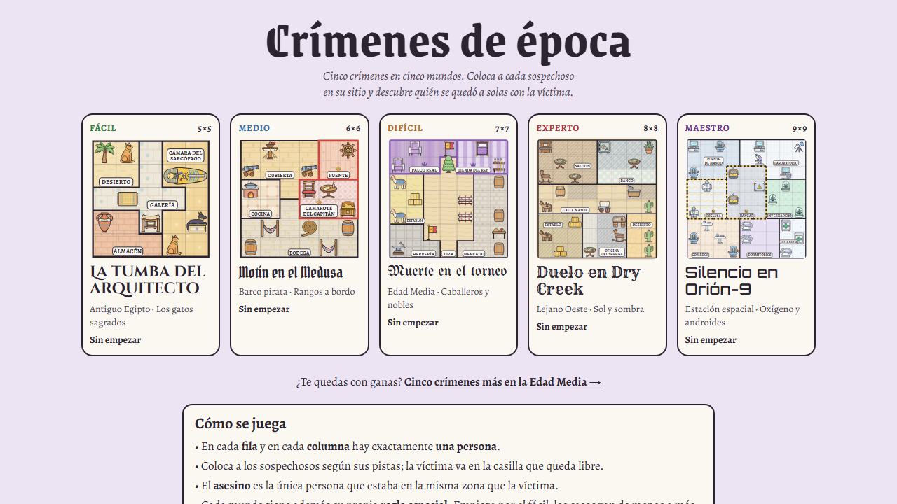

# Crímenes de época

Cinco crímenes en cinco mundos. Un sudoku de asesinatos: coloca a cada sospechoso en su sitio, uno por fila y por columna,
y descubre quién se quedó a solas con la víctima. Cada mundo tiene su propia regla especial, y los casos van del fácil al
maestro. Juego web autónomo en un único `index.html`.

**Jugar:** https://spyder-cripto.github.io/crimenes-de-epoca/ · Cinco casos más en
[la Edad Media](https://spyder-cripto.github.io/crimenes-de-epoca-edad-media/).

## Cómo se juega
- En cada **fila** y en cada **columna** hay exactamente **una persona**.
- Coloca a los sospechosos según sus pistas; la víctima va en la casilla que queda libre.
- El **asesino** es la única persona que estaba en la misma zona que la víctima.
- **Ninguna zona se quedó vacía.**
- No se puede estar en una casilla con un objeto, salvo los que se ocupan (sillas, caballos, hamacas…).
- «Al lado de» es arriba, abajo, a la izquierda o a la derecha; «al este de», en cualquier columna a su derecha (no hace falta que sea la de al lado); «al norte de», en cualquier fila más arriba.
- **Colocar**, **notas** (las iniciales de quien podría estar en cada casilla) y **tachar**; deshacer, comprobar y pistas
  opcionales, que enseñan el siguiente paso de la deducción.

## Los casos
| Nivel | Caso | Mundo | Regla especial |
|---|---|---|---|
| Fácil · 5×5 | La tumba del arquitecto | Antiguo Egipto | Los gatos sagrados: nadie puede estar al lado de un gato |
| Medio · 6×6 | Motín en el Medusa | Barco pirata | Rangos a bordo: oficiales en su zona, marineros fuera, grumetes donde quieran |
| Difícil · 7×7 | Muerte en el torneo | Edad Media | Caballeros y nobles: nobles en zona noble, plebeyos fuera, caballeros donde quieran |
| Experto · 8×8 | Duelo en Dry Creek | Lejano Oeste | Sol y sombra: forasteros a la sombra, vaqueros al sol, la ley donde quiera |
| Maestro · 9×9 | Silencio en Orión-9 | Estación espacial | Oxígeno y androides: humanos fuera de las zonas sin aire, alienígenas solo en ellas, y dos androides nunca se tocan |

Cada caso tiene una sola solución, comprobada por ordenador. En todos hacen falta la regla especial y «ninguna zona vacía»,
y no sobra ninguna pista.

Antes se llamaba «Cacería real»; la dirección antigua lleva aquí y el progreso guardado se conserva.

## Créditos
- Casos, reglas especiales, arte y textos: **Spider** (Fali + Claude), 2026.
- Inspirado en los *Murdoku* de Manuel Garand.
